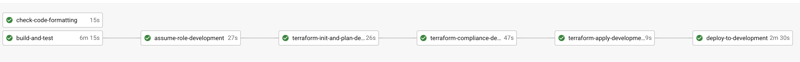

# Contributing

## Branching Strategy

This project utilises a Trunk-Based Development workflow. To see more information about this strategy, please refer to [this page on our API Playbook](https://playbook.hackney.gov.uk/API-Playbook/branching_strategies).

### Development

Automated tests (xUnit) & code linters are run on each push to any feature branch to ensure the code is of good quality. We use a pull request workflow, where changes are made on a branch and are approved by one or more other maintainers before the developer can merge into `master` branch.

Once a PR is approved and merged to the `master` branch, the application is deployed to development automatically, where we confirm that our latest changes work well.

### Staging & Production

To deploy to staging or production, we create a PR from the `master` branch to the `release` branch. Once this is approved, the application is deployed to staging automatically.
We manually confirm a production deployment in the CircleCI workflow once we're happy with our changes in staging.

## Creating a Pull Request

To help with making changes to code easier to understand when being reviewed, we've added a PR template.
When a new PR is created on a repo that uses this API template, the PR template will automatically fill in the `Open a pull request` description textbox.
The PR author can edit and change the PR description using the template as a guide.
